<div align="center">

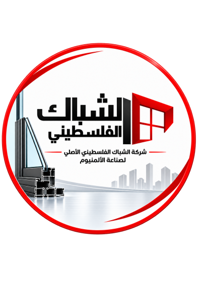

# الشباك الفلسطيني لصناعة الألمنيوم

**موقع عربي ومكتبة مرئية لشركة تصنيع وتركيب شبابيك ألمنيوم ومطابخ في الأردن: أنظمة 7000C و9000C، المطابخ، مراحل التصنيع، وطلب عرض سعر عبر واتساب.**

[](https://alshubbak-alfalastini.alshubbakalfalastini.workers.dev/)


</div>

---

## لمحة

موقع ثابت (Static) بصفحة واحدة، باتجاه RTL، متجاوب مع الهاتف، مبني بـ HTML وCSS وJavaScript دون أي إطار عمل أو مكتبة واجهة. يعمل مباشرة من `index.html` أو على أي استضافة ملفات ثابتة.

| | |
|---|---|
| **المكتبة المرئية** | 38 صورة · 9 فيديوهات · 6 أقسام |
| **الأقسام** | شبابيك 7000C · شبابيك 9000C · تجربة العزل · قصّ الألمنيوم · المطابخ · عن الشركة |
| **الصيغ** | صور WebP مع نسخ مصغّرة · فيديو MP4 بصيغة H.264/AAC · ملصقات معاينة للفيديو |
| **التواصل** | نموذج عرض سعر يجهّز رسالة واتساب · اتصال مباشر · خريطة الموقع |

## لقطات من الموقع

### الواجهة الرئيسية
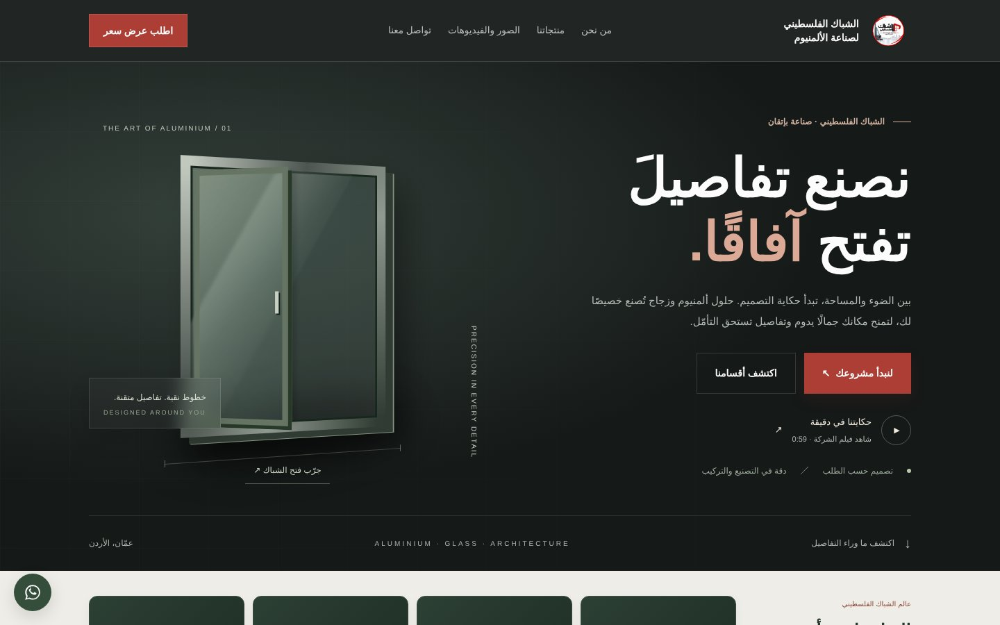

### من نحن
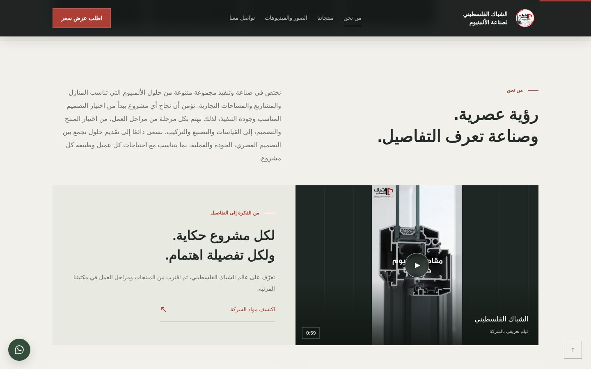

### المنتجات
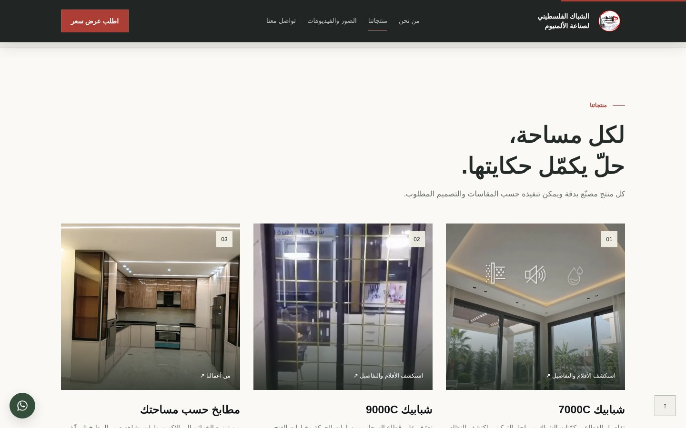

### المطابخ
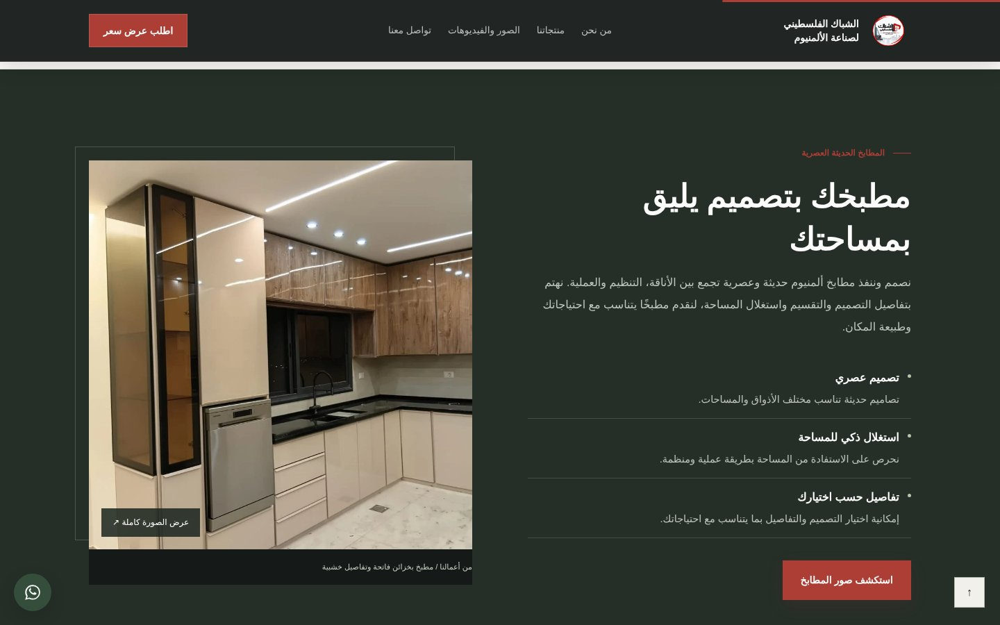

### من داخل الورشة
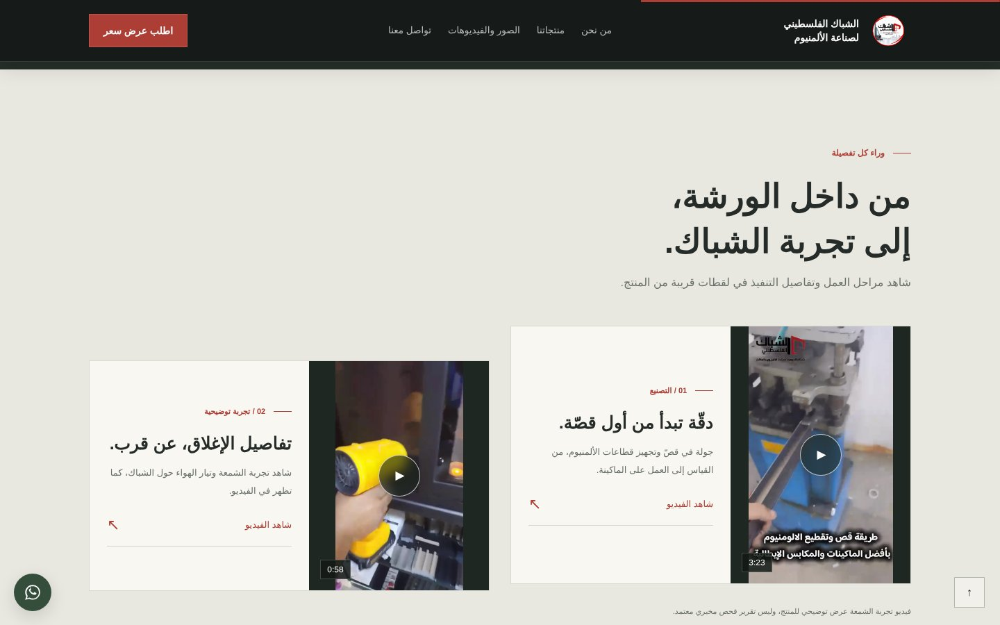

### المكتبة المرئية
| تصفية حسب القسم | عارض الصور والفيديو |
|---|---|
| 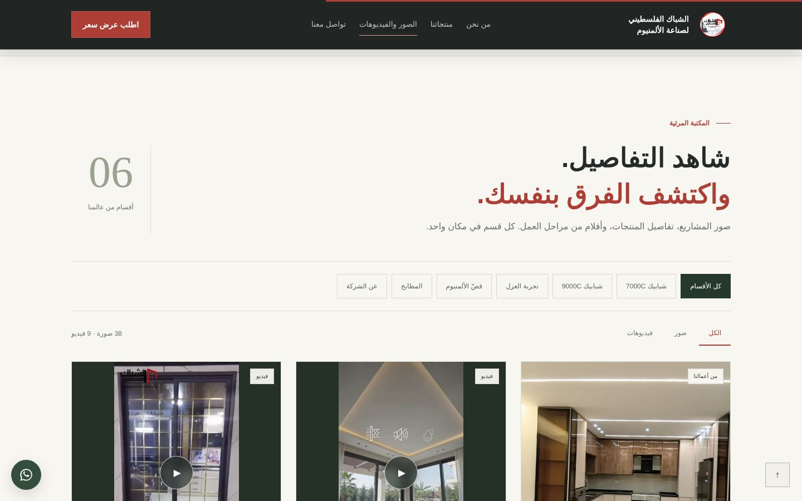 | 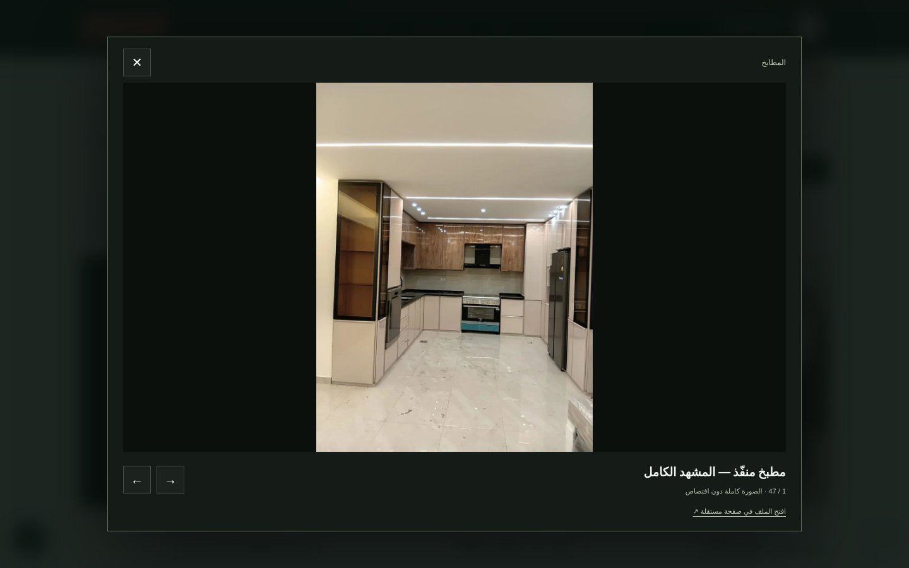 |

### طلب عرض سعر
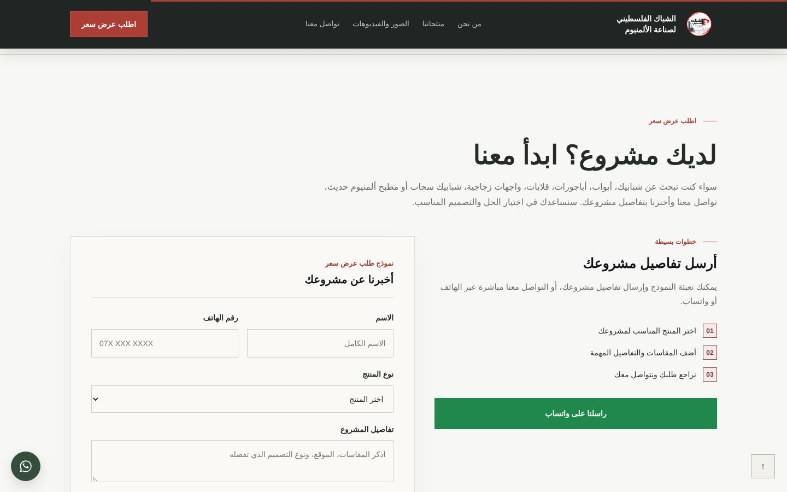

### على الهاتف
<p align="center">
  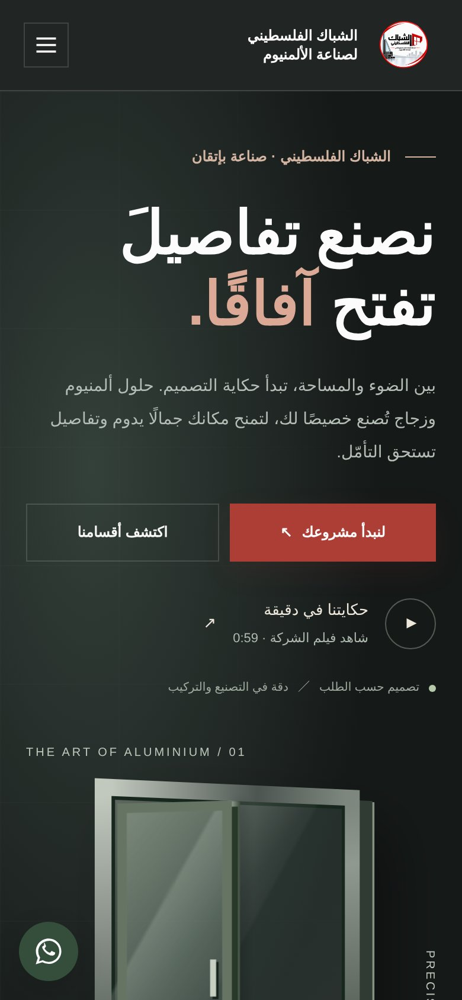
  &nbsp;&nbsp;
  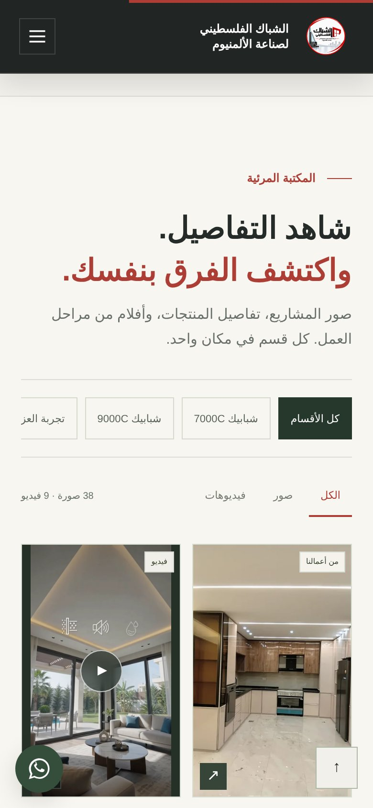
</p>

## المزايا

- **مكتبة مرئية متكاملة**: تصفية حسب القسم ونوع الوسائط (صور / فيديوهات)، وعارض بملء الشاشة مع تنقل بين المواد ولوحة المفاتيح.
- **فيديو لا يزعج الزائر**: لا يُحمَّل الفيديو ولا يعمل صوته عند فتح الصفحة أو التمرير؛ يبدأ فقط باختيار الزائر، ويتوقف عند الإغلاق أو الانتقال لمادة أخرى.
- **أداء عالٍ**: صور WebP بنسخ مصغّرة، تحميل كسول (`loading="lazy"`)، أبعاد محددة لمنع اهتزاز الصفحة، وفيديو مهيأ للتشغيل التدريجي (`faststart`).
- **طلب عرض سعر عبر واتساب**: النموذج يجهّز رسالة كاملة بالاسم والهاتف ونوع المنتج وتفاصيل المشروع.
- **وصولية**: دعم لوحة المفاتيح، نصوص بديلة لكل صورة، واحترام تفضيل تقليل الحركة (`prefers-reduced-motion`).
- **متجاوب بالكامل**: تم فحصه على مقاسات 320 و390 و768 و1440 بكسل.

## التقنيات المستخدمة

| المجال | التقنية |
|---|---|
| الواجهة | HTML5 · CSS3 (Custom Properties, Grid, Flexbox) · Vanilla JavaScript |
| الخطوط | Tajawal · IBM Plex Sans Arabic |
| معالجة الصور | Python · Pillow (تحويل WebP، نسخ مصغّرة، ملصقات الفيديو) |
| معالجة الفيديو | FFmpeg عبر `imageio-ffmpeg` (ضغط بمرحلتين H.264 + AAC) |
| الفحص | Playwright (فحص الروابط، المقاسات، أخطاء JavaScript، بصمات SHA-256 للوسائط) |
| النشر | Cloudflare (رفع مباشر لمجلد ثابت) |

## هيكل المشروع

```
├── index.html                  الصفحة كاملة ومحتوى الأقسام
├── assets/
│   ├── css/                    base · design · media
│   ├── js/                     effects · media · media-data
│   ├── brand/                  شعار الشركة
│   ├── windows-7000c/          images · videos · posters
│   ├── windows-9000c/          images · videos · posters
│   ├── kitchens/               images
│   ├── aluminium-fabrication/  videos · posters
│   ├── window-testing/         videos · posters
│   ├── about/                  images · videos · posters
│   ├── media-manifest.json     فهرس الوسائط: العناوين، الأبعاد، المدد، البصمات
│   └── source-map.json         ربط الأسماء القديمة بالأسماء المنظمة
├── tools/                      أدوات تجهيز الوسائط والبناء والفحص
└── docs/screenshots/           لقطات الشاشة في هذا الملف
```

> الملفات الأصلية الخام (`assets/*/originals/`) ومجلد النشر `cloudflare-upload/` وأدوات `.tools/` محفوظة محليًا وغير مضمّنة في المستودع لحجمها؛ الموقع يعمل بالكامل من النسخ المحسّنة الموجودة هنا.

## التشغيل محليًا

```sh
python -m http.server 8000
```

ثم افتح http://localhost:8000

---

# التوثيق التفصيلي

## الملفات

- `index.html`: الصفحة ومحتوى الأقسام ومعرض الوسائط.
- `assets/css/`: تنسيق الموقع، الحركة، المعرض ومشغّل الوسائط.
- `assets/js/`: التفاعلات وبيانات الوسائط؛ لا توجد مكتبات واجهة مطلوبة.
- `assets/brand/`: شعار الشركة الأصلي.
- `assets/windows-7000c/`: صور وفيديوهات نظام 7000C.
- `assets/windows-9000c/`: صور وفيديوهات نظام 9000C.
- `assets/kitchens/`: صور المطابخ والمواد التعريفية.
- `assets/aluminium-fabrication/`: فيديو قص وتجهيز الألمنيوم.
- `assets/window-testing/`: تجربة الشمعة وتيار الهواء.
- `assets/about/`: مواد التعريف بالشركة.
- `assets/media-manifest.json`: الفهرس الكامل، العناوين، الأبعاد، المدد والبصمات.
- `assets/source-map.json`: ربط أسماء الملفات السابقة بالأسماء المنظمة الجديدة.

داخل كل قسم: `originals` للأصول دون تعديل، `images` لصور WebP ونسخ المعاينة، `videos` لنسخ التشغيل، و`posters` لمعاينات الفيديو، بحسب محتوى القسم.

## المحتوى

تمت مراجعة الصور ولقطات موزّعة على الفيديوهات لتحديد العناوين والترتيب. تم حفظ 48 ملفًا أصليًا: 39 صورة و9 فيديوهات. توجد صورة مطبخ مكررة مطابقة؛ احتُفظ بالنسختين في الأصول، ويعرض الموقع نسخة واحدة، ليصبح المعروض 38 صورة و9 فيديوهات.

الصورة التعريفية تُعرض كاملة دون اقتصاص. صور المطبخ المنفّذ مميزة عن المواد التعريفية. الفيديو لا يُحمّل ولا يبدأ صوته عند دخول الصفحة أو التمرير؛ يبدأ بعد اختيار الزائر، مع أدوات التشغيل والصوت. إغلاق المشغّل أو الانتقال إلى مادة أخرى يوقف الفيديو السابق.

التصميم يدعم العربية واتجاه RTL والموبايل ولوحة المفاتيح وتفضيل تقليل الحركة. نموذج عرض السعر يفتح رسالة واتساب جاهزة؛ الإرسال يتم من واتساب.

## النشر والصيانة

### الرفع إلى Cloudflare

المجلد الجاهز للنشر هو **`cloudflare-upload` فقط**. في شاشة الرفع اضغط **Remove all** لإزالة الاختيار السابق، ثم اسحب مجلد `cloudflare-upload`. تأكد أن `index.html` ومجلد `assets` يظهران في جذر الملفات المختارة، ثم اضغط **Deploy**.

لا تسحب مجلد المشروع `w` كاملًا. نسخة الرفع تحتوي التصميم نفسه وجميع الوسائط المعروضة. الفيديوهان الكبيران مضغوطان كاملين مع الصوت، وكل ملف في النسخة أقل من 24 MB. جميع ملفات الصور والتصميم مطابقة للموقع الأصلي. النسخ الأصلية محفوظة دون تعديل في مجلد `assets` الرئيسي.

لتحديث مجلد النشر بعد تعديل الموقع:

```powershell
python tools/build_cloudflare.py
```

الأمر يتطلب أدوات الفيديو المحلية في `.tools/python`، ويعيد إعداد نسخة الرفع وفحص الملفات. لفحص نسخة الرفع بالمتصفح:

```powershell
python tools/check_site.py cloudflare-upload
```

مجلدات `.tools` و`.review` و`tools` و`originals` أدوات وأصول محلية وليست ضمن حزمة النشر.

الخطوط وخريطة الموقع تستخدم Google، وباقي الصور والفيديوهات محلية. يُنصح بأن تدعم الاستضافة طلبات HTTP Range للفيديو وتخزين الأصول مؤقتًا.

ملفات `tools/inspect_media.py` و`inspect_videos.py` و`prepare_assets.py` و`build_site.py` توثّق عملية الاستيراد الأولى، وليست أمر بناء يوميًا؛ لا تُعِد تشغيلها على النسخة النهائية. لفحص الموقع، يستخدم `tools/check_site.py` أدوات Playwright المحلية ومتصفح Chrome المثبّت. تقارير وصور الفحص محفوظة محليًا داخل `.review`.
